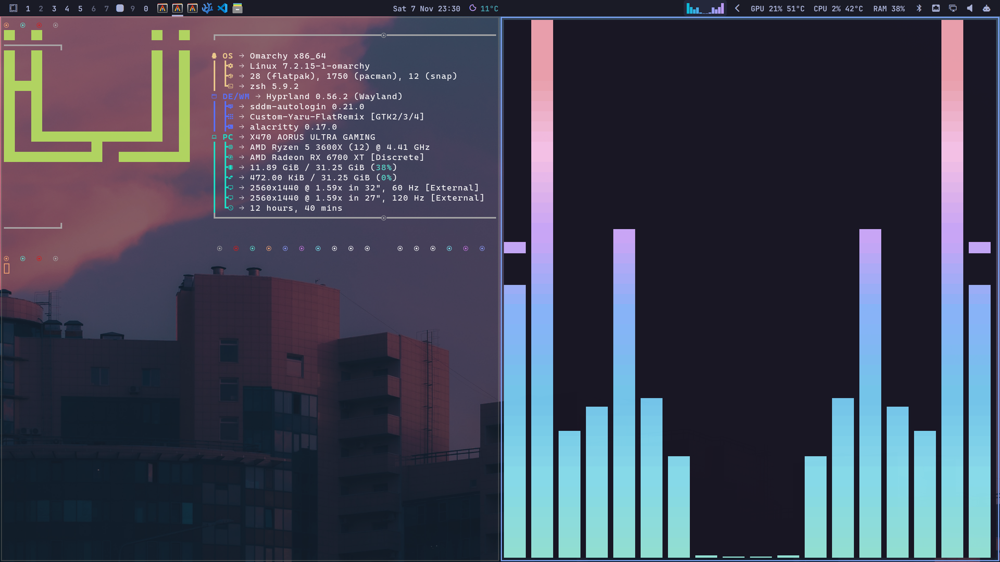

# 🖥️ Omarchy Quattro dotfiles

[](https://omarchy.org)
[](https://hyprland.org)
[](https://archlinux.org)
[](https://www.zsh.org)
[](https://alacritty.org)



Personal Hyprland (Lua config) and Omarchy shell bar setup for Omarchy 4.5
"Quattro" (Hyprland 0.56). Files under `home/` mirror their place in `$HOME`.

## 📦 Install

```bash
./install.sh
```

It copies everything into `$HOME`, backing up any file it replaces as
`<file>.bak.<timestamp>`, enables the notification sound, masks SwayNC, reloads
Hyprland and restarts the shell.

🧰 Needs: `cava`, `pamixer`, `python-gobject` and `evolution-data-server` (calendar
events), `dbus` (`dbus-monitor`), `libpulse` (`paplay`), `git`, and
`ttf-cascadia-code-nerd` (Alacritty font).

## 🗂️ Monitors and workspaces

Assumes two monitors, **DP-1** and **DP-3**. Change the names in
`hypr/monitors.lua`, `hypr/bindings.lua`, `hypr/autostart.lua` and
`omarchy/plugins/alex.workspaces/Workspaces.qml` for other setups.

- 🔢 Workspaces 1–9 live on DP-1; workspace **0** lives on DP-3. Hyprland ids
  start at 1 and Omarchy gives each monitor a block of ten, so workspace 0 is
  id 20, named "0".
- ⌨️ `SUPER+1..9` / `SUPER+0` go to them from either monitor; `SUPER+SHIFT` moves
  the window (`+ALT` silently).
- 🔁 `SUPER+LEFT/RIGHT`, `SUPER+TAB` / `SUPER+SHIFT+TAB`, `SUPER+scroll` and
  scrolling on the bar's workspaces step around one loop: 1…9, 0, back to 1.
- 🧱 Default layout is tiling (dwindle).

## 📊 Bar (`omarchy/shell.json` and plugins)

- 🙈 Hidden on DP-3. Opaque, no double-click transparency, JetBrainsMono Nerd
  Font Bold (`.local/share/fonts`, renamed family "JetBrainsMono Nerd Font Bar").
- 🗃️ `alex.workspaces`: DP-1 shows 1–9 plus a 0 button; clicking the current
  workspace does nothing (no layout cycling).
- 📌 `bar/modules/taskbar.qml`: open apps on this monitor, click to focus,
  middle-click to close.
- 📅 `alex.clock`: calendar popup; click a day to see its Evolution Data Server
  events (`bar/scripts/calendar-events`).
- 🌤️ `alex.weather`: icon and temperature, each colored from the theme.
- 🎵 `bar/modules/cava.qml`: colored Cava visualizer on a lighter panel; click to
  play/pause, scroll for volume.
- 📈 GPU / CPU / RAM stats from `bar/scripts/system-stat`.
- 🚦 Indicators trimmed to screen recording, remote session, DND and stay awake.

## ⚙️ Other

- 🔔 Omarchy notifications with the old SwayNC sound
  (`systemd/user/notification-sound.service`).
- 🦁 Brave opens on workspace 0 and takes focus.
- 🚀 Autostart: Alacritty (ws 1), Nemo (ws 3, +5 s), Brave (+5 s, focus returns
  to Alacritty), Telegram in tray (+15 s), Steam in tray (+20 s).
- 💻 Alacritty (`.config/alacritty`): CaskaydiaCove Nerd Font Mono 10, 50%
  opacity, no decorations, starts maximized, zsh, underline blinking cursor,
  `thelovelace_edit` theme (others in `themes/`), `SUPER+SHIFT+Return` opens a
  new instance. `print_colors.sh` prints the palette.
- 🐚 Zsh (`.zshrc`, `.zshenv`, `.p10k.zsh`, `.zsh/`): Powerlevel10k prompt,
  autosuggestions, syntax highlighting and completions (cloned by
  `install.sh`), eza `ls` aliases, pacman aliases, zoxide, nvm, Helix as git
  editor, history in `~/.zsh/.zsh_history` (not included). Needs `eza`,
  `zoxide`, `nvm`, `fastfetch` and `helix`.
- ✏️ Helix (`.config/helix`): `my_theme` (snazzy with a transparent
  background), `Ctrl+S` saves, `Insert` enters insert mode. The template and
  "Language support configuration" files are reference only; Helix loads
  `config.toml` and `themes/`.
- 🖼️ Fastfetch (`.config/fastfetch`): personal configs `config.ale.jsonc`,
  `config2.jsonc` and `config.333.jsonc` with ASCII art and images; run one
  with `fastfetch -c ~/.config/fastfetch/config.ale.jsonc`. Plain `fastfetch`
  uses Omarchy's default (`/etc/fastfetch/config.jsonc`).
- 🎶 Cava (`.config/cava`): standalone terminal visualizer config (PulseAudio
  input, ncurses output), with `config tokyo night` as a saved copy, extra
  themes and shaders. The bar's visualizer uses its own
  `.config/omarchy/bar/cava.conf`.
- 🔐 Private exports (BrowserStack credentials) go in `~/.zshrc.secrets`,
  which `.zshrc` sources if present. It is not part of these dotfiles.
- 🔍 `SUPER+R` and `omarchy-launch-walker` open Quattro's app launcher.
- 🎨 Icon theme **Yaru+FlatRemix+Plus** (`Custom-Yaru-FlatRemix`), cloned by
  `install.sh` from
  [aleame/Yaru-FlatRemix-Plus](https://github.com/aleame/Yaru-FlatRemix-Plus)
  into `~/.icons`, with a link at `~/.local/share/icons`. The app launcher
  ignores the selected theme and uses the first icon it finds, searching
  `~/.icons` first, so the theme must live there for its icons to show.
